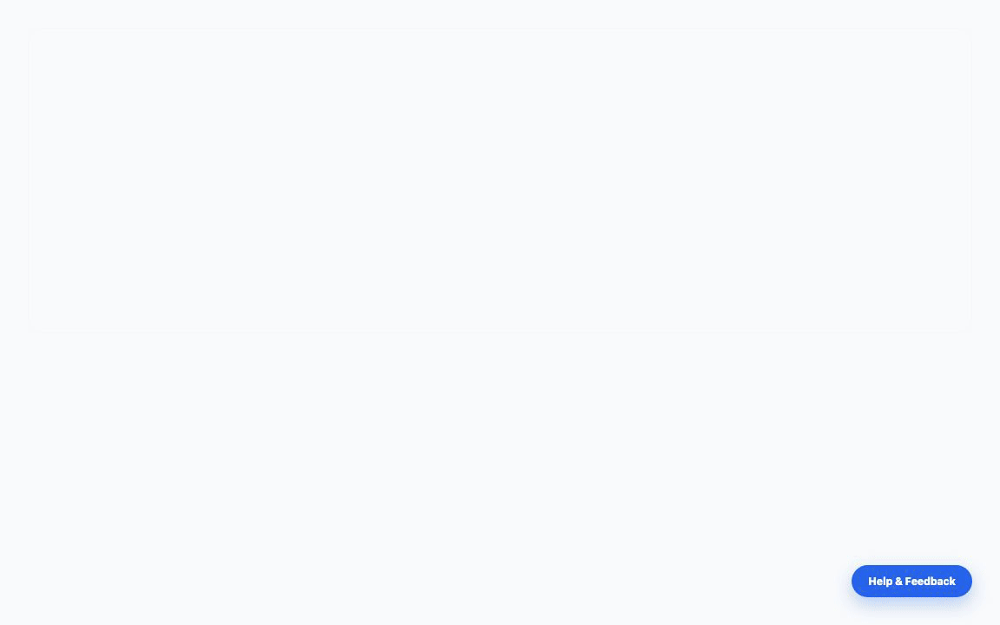

# @reactkits.dev/react-engage

A lightweight, reskinnable, embeddable React component package for user engagement: feedback widgets, bug reporting with auto-telemetry, feature suggestions, newsletter subscriptions, broadcasts, FAQs, and support ticketing.

<p align="center">
  
</p>

## Features and Workflows

### 1. Embedded Floating Widget (`EngageWidget`)
- **Newsletter Subscription**: Direct email signup tab with confirmation feedback.
- **Feature Suggestions**: Users can submit ideas, view existing requests, and vote.
- **Bug Reporting**: Auto-captures browser context, route URL, OS, viewport size, and timestamp for effortless debugging.
- **Support Tickets and FAQs**: Embedded FAQ search and support ticket creation.
- **My Tickets**: Signed-in users can review their own bug reports, suggestions, support requests, and current statuses.

### 2. In-App Management Panel (`EngageAdminPanel`)
- **Support Inbox**: Split view to inspect bug reports with auto-captured metadata (URL, browser, OS, screen resolution) and reply via email.
- **Audience & Newsletters**: Send and track product announcements & newsletter emails.
- **Email Templates**: Edit welcome emails, ticket reply templates, and broadcast newsletters.

---

## Installation

```bash
npm install @reactkits.dev/react-engage lucide-react
```

## Quick Start

Import the widget and styles near your application root:

```tsx
import { EngageWidget } from '@reactkits.dev/react-engage';
import '@reactkits.dev/react-engage/styles.css';

export default function App() {
  return (
    <EngageWidget
      appId="my-app"
      position="bottom-right"
      theme="inherit"
      endpointUrl="/api/engage"
      user={session?.user}
      content={{
        launcher: { title: 'Help Center' },
        faq: {
          items: [
            {
              id: 'getting-started',
              question: 'How do I get started?',
              answer: 'Create your first project from the dashboard.',
              category: 'Getting Started',
              externalUrl: '/docs/getting-started',
            },
          ],
        },
        newsletter: {
          subscribeDescription: 'Get product release notes by email.',
        },
      }}
    />
  );
}
```

## Host-owned content

`react-engage` owns interaction and presentation; the host application owns its
product help and language. Pass a partial `content` object to customize any
end-user string. Overrides are deep-merged with product-neutral defaults, so an
app may replace one label or the complete catalog.

The typed `EngageWidgetContent` contract covers:

- launcher, drawer accessibility labels, and navigation tabs
- FAQ items, search, empty state, categories, and article links
- bug, suggestion, and support form labels, placeholders, validation, success,
  payload fallback titles, option labels, and buttons
- community roadmap header, sort/category filters, status badges, empty state,
  and optional `sampleItems` shown when no endpoint data is available
- ticket list labels, loading/errors, empty states, and reply text
- newsletter form, confirmation states, frequency options, and actions

Dynamic values use named tokens where documented by the default content:
`{path}`, `{browser}`, `{os}`, and `{email}`. `faqs` and the flat `labels` prop
remain supported for compatibility; new integrations should prefer `content`.

```tsx
import type { EngageWidgetContentOverrides } from '@reactkits.dev/react-engage';

export const engageContent = {
  tabs: { faq: 'Guides' },
  feedback: {
    messagePlaceholders: {
      bug: 'e.g. The invoice preview is blank after I change the date',
    },
  },
  suggestions: {
    headerTitle: 'Product Roadmap',
    // Seed the roadmap until your endpoint returns data (defaults to none):
    sampleItems: [
      {
        id: 'seed_1',
        appId: 'my-app',
        title: 'Slack notifications',
        description: 'Notify a channel when an invoice is paid.',
        category: 'integrations',
        status: 'planned',
        upvotes: 12,
        createdAt: '2026-01-01T00:00:00.000Z',
      },
    ],
  },
} satisfies EngageWidgetContentOverrides;
```

If help articles come from a CMS, fetch them in the host application and pass
the resulting array as `content.faq.items`. The package does not impose a CMS or
store domain documentation in its own database.

## Core Exports

- `EngageWidget`: Floating engagement widget for users.
- `EngageAdminPanel`: In-app admin dashboard for managing broadcasts, subscribers, and feedback.
- `@reactkits.dev/react-engage/server`: Next.js route handler factory (`createEngageRouteHandler`).

`EngageAdminPanel` also accepts host-owned `initialTemplates` and
`initialBroadcastSubject`. Server notification identity remains configurable
through `adminEmail`, `senderEmail`, and `senderName` on
`createEngageRouteHandler`. Its `emailContent` option accepts host renderers for
welcome, admin-notification, and newsletter-broadcast emails, so no product
identity or email copy needs to live in the reusable server package.

The `My Tickets` endpoint is authenticated by the host application. Configure
`resolveRequestUser` on `createEngageRouteHandler` and return the current user's
email. Set `isAdmin` for users who may access the admin lists and actions.

## Theme Support

Supports `inherit`, `system`, `light`, and `dark` modes with semantic tokens (`--card-bg`, `--card-border`, `--accent`, `--foreground`, `--muted`).

## Mobile & Positioning Customization

To clear host mobile navigation bars or customize placement:

```tsx
<EngageWidget
  appId="my-app"
  position="bottom-right"
  offsetBottom="80px"     // Elevates launcher above mobile bottom nav bars
  mobileCollapse={true}   // Automatically collapses to circular icon on screens <= 640px
/>
```

## Email helpdesk

The optional email workspace lives in the existing ticket system. It includes
an inbox, conversation replies, a plain-text composer, and sent/outbox history.
Email conversations are support tickets: incoming replies reopen the ticket,
and replies from the support panel share the same email history.

```tsx
import { EngageAdminPanel, EmailDesk } from '@reactkits.dev/react-engage/admin';
import '@reactkits.dev/react-engage/styles.css';

// Inside the full helpdesk:
<EngageAdminPanel apiEndpoint="/api/engage" mailbox defaultTab="email" theme="inherit" />

// Or mount only email in any React 18/19 app:
<EmailDesk apiEndpoint="/your/helpdesk-api" theme="system" />
```

`EmailDesk` accepts a typed `client: EmailClient` for custom HTTP, GraphQL, or
other backends. `EmailComposer` is also exported and accepts `sender` and an
`onSend(draft)` callback. Neither React component imports Next.js or contains
application identities, API keys, or mailbox passwords.

### Backend and persistence

For Next.js, configure the existing route handler:

```ts
import { createEngageRouteHandler } from '@reactkits.dev/react-engage/server';

export const { GET, POST } = createEngageRouteHandler({
  senderEmail: 'hello@your-domain.example',
  senderName: 'Your support team',
  apiKey: process.env.BREVO_API_KEY,
  resolveRequestUser: async request => {
    const user = await resolveYourSession(request);
    return user ? { email: user.email, isAdmin: user.isAdmin } : null;
  },
  mailbox: {
    store: yourDatabaseEmailStore,
    inboundSecret: process.env.ENGAGE_INBOUND_SECRET,
  },
});
```

For another Node backend, `@reactkits.dev/react-engage/email-server` exports
`createEngageEmailHandler`, which uses standard `Request` and `Response` and
has no Next.js dependency. Supply `sender`, `getApiKey`, `authorize`, and the
same mailbox options, then call `handler.handle(request, action)`.

Hosts implement the exported `EmailStore` contract with their database:
`listThreads`, `getConversation`, `findMessage`, `findByProviderId`,
`reserveMessage`, `updateDelivery`, and `markRead`. Reserve messages atomically
with their support ticket before contacting the provider; deduplicate message
IDs and provider IDs. `createMemoryEmailStore` is isolated demo/test storage,
not durable production storage. Keep each application/tenant's store scoped to
its own mailbox. The optional `transport: EmailTransport` replaces Brevo while
preserving the same workflow.

The default transport reads `apiKey`, `ENGAGE_API_KEY`, or `BREVO_API_KEY` on the
server. Both From and Reply-to use the configured server sender; client input
cannot override them. Every outgoing attempt has a client-generated request
ID. Accepted attempts are replay-safe; failed, pending, and unconfirmed attempts
stay visible in the outbox. Network uncertainty never causes automatic resend.
“Accepted for delivery” means provider acceptance, not confirmed inbox delivery.

### Incoming email

Connect an email provider/Worker to `POST ?action=receive_email`, authenticated
with `Authorization: Bearer <ENGAGE_INBOUND_SECRET>` (32+ random characters).
The normalized JSON contract is:

```json
{
  "messageId": "<unique-message-id@example.com>",
  "from": "customer@example.com",
  "fromName": "Customer",
  "to": "hello@your-domain.example",
  "subject": "Question",
  "text": "Plain-text message",
  "inReplyTo": "<previous-provider-message-id@example.com>",
  "references": ["<previous-provider-message-id@example.com>"],
  "attachments": [{ "name": "report.pdf", "contentType": "application/pdf", "size": 1234 }]
}
```

Message-ID retries are deduplicated. Referenced replies join an existing ticket
only when the sender matches that ticket's contact; unrelated senders create a
new ticket. Bodies render as plain text, never executable email HTML. This
initial version lists attachment metadata; the forwarded mailbox copy retains
attachment files. It does not synchronize Gmail read states, ingest historic
Gmail mail, or provide delivery/bounce webhooks.

A deployable [Cloudflare Email Worker example](examples/cloudflare-email-worker/README.md)
parses MIME, converts HTML-only emails to text, optionally forwards a complete
copy to your existing mailbox, and stores failed ingestion in KV for scheduled
retry. Configure and deploy that adapter separately; enabling the React UI does
not change domain routing.
